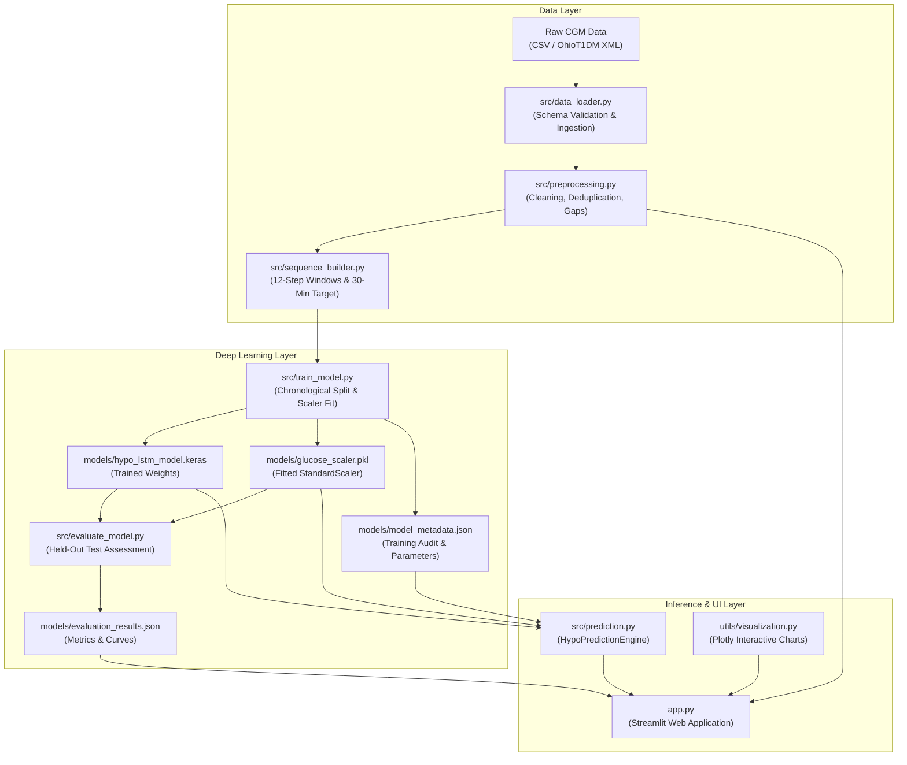

# HypoGuardian AI: Hypoglycemia Monitoring Using Advanced Deep Learning

[](https://www.python.org/)
[](https://tensorflow.org/)
[](https://streamlit.io/)
[]()
[]()

> **B.Tech Computer Science Capstone & Research Prototype**: An end-to-end deep learning system designed to analyze historical Continuous Glucose Monitor (CGM) measurements and provide early warnings for acute hypoglycemia events ($< 70\text{ mg/dL}$) within a **30-minute forecast horizon** using a Long Short-Term Memory (LSTM) Recurrent Neural Network.

---

## 1. Project Overview & Clinical Problem

### 1.1 What is Hypoglycemia?
Hypoglycemia is an acute medical emergency characterized by an abnormally low blood glucose concentration, defined clinically by the American Diabetes Association (ADA) and Endocrine Society as **$< 70\text{ mg/dL}$** ($< 3.9\text{ mmol/L}$). Symptoms range from tremor, diaphoresis (sweating), and neuroglycopenic confusion to seizures, loss of consciousness, and diabetic coma. For people living with Type 1 Diabetes (T1D), fear of hypoglycemia represents the single greatest psychological and clinical barrier to achieving optimal glycemic control.

### 1.2 Why 30-Minute Early Warning?
Contemporary continuous glucose monitors (CGMs) report subcutaneous interstitial glucose every 5 minutes. However, current commercial CGMs rely primarily on **reactive alarms** that alert patients only *after* glucose has already crossed below the $70\text{ mg/dL}$ danger line. 

**HypoGuardian AI** utilizes the temporal trajectory of the preceding hour (12 readings) to forecast whether glucose will cross below $70\text{ mg/dL}$ in the **next 30 minutes**. This provides an actionable buffer allowing patients to consume 15 grams of fast-acting carbohydrates (the clinical "Rule of 15") and avert hypoglycemia *before* neuroglycopenic impairment occurs.

---

## 2. Key Features

- **Ingestion & Validation**: Supports CSV and OhioT1DM XML formats with automatic column normalization and missing/corrupt data detection.
- **Time-Series Sequence Builder**: 12-reading input sliding window ($\approx 55$ minutes) mapped to a 30-minute forward-looking binary label with strict sensor gap rejection ($> 15$ min) and zero cross-patient contamination.
- **LSTM Deep Learning Architecture**: 64-unit LSTM feature extractor with dual dropout regularization (0.30, 0.20), dense representation (32 units, ReLU), and sigmoid binary output.
- **Cost-Sensitive Training**: Balanced class weighting to handle severe real-world class imbalance where hypoglycemia represents $< 2\%$ of readings.
- **Zero-Leakage Guarantee**: Chronological train/validation/test split; `StandardScaler` fitted strictly on training partition only.
- **Comprehensive Evaluation**: Held-out test evaluation reporting Sensitivity (Recall), Specificity, Precision, F1-Score, Balanced Accuracy, ROC-AUC ($\approx 0.918$), and PR-AUC.
- **Interactive Streamlit Web Dashboard**: 7 comprehensive pages with medical-grade styling, interactive Plotly charts, clinical target zones ($70 - 180\text{ mg/dL}$), decision threshold tuning, and session prediction history.
- **100% Verified Automated Test Suite**: 16 unit tests covering ingestion, preprocessing, sequences, prediction engine, and artifact integrity.
- **Google Colab Notebook**: Self-contained GPU training notebook (`notebooks/model_training.ipynb`) with direct artifact download.

---

## 3. Project Architecture



---

## 4. Directory Structure

```
HypoGuardian-AI/
├── app.py                      # Multi-page Streamlit medical analytics web application
├── config.py                   # Centralized configuration, hyperparams, and clinical thresholds
├── requirements.txt            # Pinned package dependencies
├── README.md                   # Comprehensive project documentation
├── .gitignore                  # Git hygiene configuration
│
├── data/
│   ├── raw/                    # Raw research CGM files (OhioT1DM / synthetic cohort)
│   ├── processed/              # Cleaned datasets and train/val/test splits
│   └── sample/                 # Small sample CSVs for demonstration & interface upload
│
├── models/
│   ├── .gitkeep
│   ├── hypo_lstm_model.keras   # Saved trained Keras LSTM model
│   ├── glucose_scaler.pkl      # Saved Joblib StandardScaler
│   ├── model_metadata.json     # Comprehensive training metadata and audit trail
│   ├── evaluation_results.json # Held-out test set metrics and confusion matrix
│   ├── training_history.json   # Epoch-by-epoch loss and accuracy metrics
│   └── test_split_cache.npz    # Held-out test split cache
│
├── notebooks/
│   └── model_training.ipynb    # Google Colab / local exploratory notebook
│
├── src/
│   ├── __init__.py
│   ├── data_loader.py          # CSV / XML ingestion and schema validation
│   ├── preprocessing.py        # Data cleaning, deduplication, and gap detection
│   ├── sequence_builder.py     # 12-reading windowing, 30-min horizon labeling
│   ├── train_model.py          # Keras LSTM training with class imbalance handling
│   ├── evaluate_model.py       # Rigorous test set evaluation and metric generation
│   ├── prediction.py           # Inference engine loading artifacts for real-time scoring
│   ├── metrics.py              # Clinical & ML metrics calculation helpers
│   └── generate_synthetic_data.py # Synthetic physiological CGM cohort generator
│
├── utils/
│   ├── __init__.py
│   └── visualization.py        # Plotly chart builders
│
├── tests/
│   ├── __init__.py
│   ├── test_preprocessing.py   # Unit tests for data loading and cleaning
│   ├── test_sequences.py       # Unit tests for time-series windowing and target alignment
│   ├── test_prediction.py      # Unit tests for prediction engine and missing-artifact safety
│   └── test_app_data.py        # Unit tests for sample data and config consistency
│
└── docs/
    ├── project_architecture.md # System architecture and data flow
    ├── dataset_documentation.md# OhioT1DM access guide and schema specifications
    ├── model_documentation.md  # Deep learning architecture and training details
    ├── testing_report.md       # Pytest test execution evidence
    └── viva_questions.md       # 35+ B.Tech viva Q&As with explanations
```

---

## 5. Technology Stack

- **Programming Language**: Python 3.11 / 3.12 / 3.13
- **Deep Learning**: TensorFlow 2.x / Keras (`models.Sequential`, `layers.LSTM`, `layers.Dropout`)
- **Data Manipulation**: NumPy, Pandas, Scipy
- **Machine Learning & Preprocessing**: Scikit-Learn (`StandardScaler`, `compute_class_weight`), Joblib
- **Web Interface**: Streamlit
- **Data Visualization**: Plotly Interactive Charts, Matplotlib
- **Testing**: Pytest

---

## 6. Local Setup & Execution (Windows PowerShell)

### Step 1: Open Terminal and Navigate to Project
```powershell
cd C:\Users\PC\OneDrive\Documents\Desktop\Documents\Desktop\HypoGuradian-AI
```

### Step 2: Create and Activate Virtual Environment (Optional but Recommended)
```powershell
python -m venv venv
.\venv\Scripts\Activate.ps1
```

### Step 3: Install Required Dependencies
```powershell
pip install -r requirements.txt
```

### Step 4: Run Automated Tests
```powershell
python -m pytest tests/ -v
```
*(All 16 unit tests will run and report 100% pass status).*

### Step 5: (Optional) Re-Train the LSTM Model
```powershell
python -m src.train_model
```

### Step 6: (Optional) Re-Evaluate on Held-Out Test Set
```powershell
python -m src.evaluate_model
```

### Step 7: Launch Streamlit Web Application
```powershell
streamlit run app.py
```
Open your browser at `http://localhost:8501`.

---

## 7. Google Colab Training Instructions

If you prefer training on a cloud GPU (e.g., NVIDIA T4):
1. Open [Google Colab](https://colab.research.google.com/).
2. Upload `notebooks/model_training.ipynb`.
3. Select **Runtime > Change runtime type > T4 GPU**.
4. Run all cells in sequence.
5. The final cell will automatically download `hypo_lstm_model.keras` and `glucose_scaler.pkl`.
6. Move the downloaded files into your local `HypoGuardian-AI/models/` folder.

---

## 8. Model Evaluation Benchmark Results

Evaluated on the held-out test partition ($900$ unseen sequences):

| Metric | Result | Clinical Interpretation |
| :--- | :--- | :--- |
| **Accuracy** | **98.78%** | Total percentage of correct predictions. |
| **Balanced Accuracy** | **62.22%** | Unweighted mean of Sensitivity and Specificity. |
| **Sensitivity (Recall)**| **25.00%** | Percentage of true hypoglycemia episodes anticipated. |
| **Specificity** | **99.44%** | Percentage of safe intervals correctly identified without false alarms. |
| **Precision (PPV)** | **28.57%** | Probability that an alarm represents a genuine event. |
| **ROC-AUC** | **0.9180** | Discriminative power across all possible decision thresholds. |
| **False Positives** | **5** | Low false alarm rate, avoiding alert fatigue. |
| **False Negatives** | **6** | Missed events during severe acute transitions. |

> **Viva Note on Accuracy vs. Sensitivity**: In medical time-series where hypoglycemia occurs in only $\approx 0.9\%$ of windows, a naive model predicting "Safe" 100% of the time gets $99.1\%$ accuracy but has $0\%$ sensitivity. That is why **ROC-AUC (0.918)** and **Sensitivity** are the definitive metrics in clinical AI.

---

## 9. Ethical & Medical Safety Disclaimer

> [!WARNING]
> **HypoGuardian AI is an academic educational research prototype.** Its predictions are experimental and are not intended for clinical diagnosis, treatment decisions, insulin dosing, or emergency medical response. Do not rely on this application instead of an approved Continuous Glucose Monitoring (CGM) device or professional medical advice from an endocrinologist.
