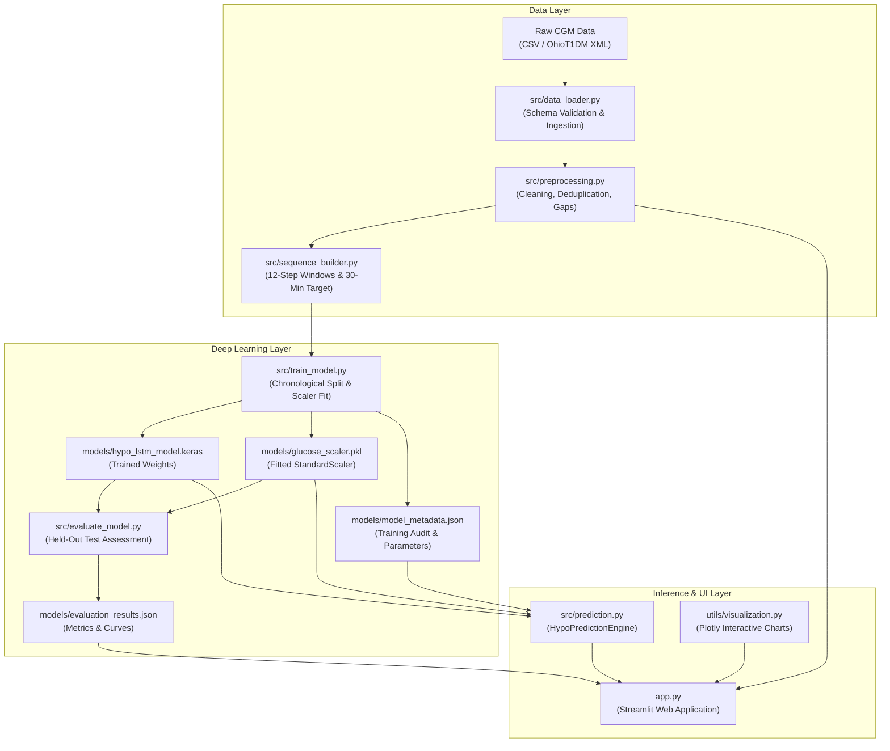

# HypoGuardian AI: Project Architecture Documentation

## 1. Architectural Overview

HypoGuardian AI is engineered as a modular, decoupled deep-learning pipeline designed for continuous glucose monitoring (CGM) time-series forecasting. The architecture separates data ingestion, validation, sequence engineering, model training, held-out evaluation, real-time inference, and user presentation.

---

## 2. Core Modules & Component Responsibilities

### 2.1 Configuration Layer (`config.py`)
- Defines immutable constants across the entire repository to prevent magic numbers.
- **`SEQUENCE_LENGTH = 12`**: Represents 12 consecutive observations at 5-minute sampling intervals ($\approx 55$ minutes of historical context).
- **`FORECAST_HORIZON_STEPS = 6`**: Represents the forward-looking 30-minute prediction window ($6 \times 5\text{ min} = 30\text{ min}$).
- **`HYPO_THRESHOLD_MG_DL = 70.0`**: Clinical threshold defining acute hypoglycemia according to the American Diabetes Association (ADA).
- **`MAX_GAP_MINUTES = 15.0`**: Maximum allowable sensor latency before temporal continuity is considered broken.

### 2.2 Data Ingestion Layer (`src/data_loader.py`)
- Ingests CSV files, in-memory string buffers, and OhioT1DM XML formats.
- Normalizes column aliases (`time`, `datetime`, `bg`, `glucose_value` $\to$ `timestamp`, `glucose`).
- Populates fallback patient identifiers (`patient_id`) to ensure consistent grouping.
- Enforces strict schema validation; raises descriptive errors on missing mandatory headers or empty datasets.

### 2.3 Preprocessing & Auditing Pipeline (`src/preprocessing.py`)
- Converts timestamps to standardized UTC-naive `datetime` objects.
- Casts glucose measurements to floating-point numbers.
- Drops physiologically impossible values ($< 20\text{ mg/dL}$ or $> 500\text{ mg/dL}$).
- Performs chronological sorting per patient identifier.
- Deduplicates timestamps, preserving the first valid reading.
- Calculates delta times to detect sensor disconnects ($> 15\text{ min}$) without corrupting original recordings.
- Emits an immutable `CleaningAuditReport` for dashboard visibility.

### 2.4 Time-Series Sequence Builder (`src/sequence_builder.py`)
- Implements a non-leaking sliding window algorithm.
- Input Window: $[t_{-11}, t_{-10}, \dots, t_0]$ of shape `(12, 1)`.
- Forecast Target: $y = 1$ if $\min(G_{t+1}, \dots, G_{t+6}) < 70.0\text{ mg/dL}$, else $y = 0$.
- Rejects any window containing sensor disconnect gaps ($> 15\text{ min}$) or non-positive intervals.
- Enforces absolute patient boundaries: sequences never merge data from two different patient IDs.

### 2.5 Training Pipeline (`src/train_model.py`)
- Employs strict chronological splitting ($70\%$ train, $15\%$ validation, $15\%$ test).
- Fits `StandardScaler` strictly on the training partition (`X_train`) to avoid data leakage.
- Computes balanced class weights via `compute_class_weight` to counteract severe class imbalance (where hypoglycemia accounts for $< 2\%$ of observations).
- Uses `EarlyStopping` (monitoring `val_loss`, patience=7) and `ReduceLROnPlateau` (factor=0.5, patience=3).
- Serializes trained model (`.keras`), scaler (`.pkl`), and audit metadata (`.json`).

### 2.6 Evaluation Engine (`src/evaluate_model.py` & `src/metrics.py`)
- Tests exclusively on the untouched held-out test split.
- Calculates clinical metrics: Sensitivity / Recall, Specificity, Precision, F1-Score, Balanced Accuracy, ROC-AUC, and Precision-Recall AUC (PR-AUC).
- Exports structured results and Matplotlib/Plotly figures.

### 2.7 Prediction Engine (`src/prediction.py`)
- Encapsulates `HypoPredictionEngine`.
- Verifies artifact existence and graceful fallbacks when weights are absent.
- Validates sequence length, interval continuity, and numerical ranges prior to inference.
- Scales inputs with the exact pre-fitted scaler.
- Executes forward pass and formats human-readable clinical risk advisories.

### 2.8 Streamlit Dashboard (`app.py` & `utils/visualization.py`)
- 7 comprehensive operational pages: Home Dashboard, Data Upload & Audit, Glucose Analytics, Early-Warning Prediction, Prediction Audit History, Model Performance, and Viva Preparation.
- Features medical-grade Plotly interactive visualizations with shaded clinical target ranges ($70\text{ to }180\text{ mg/dL}$).
